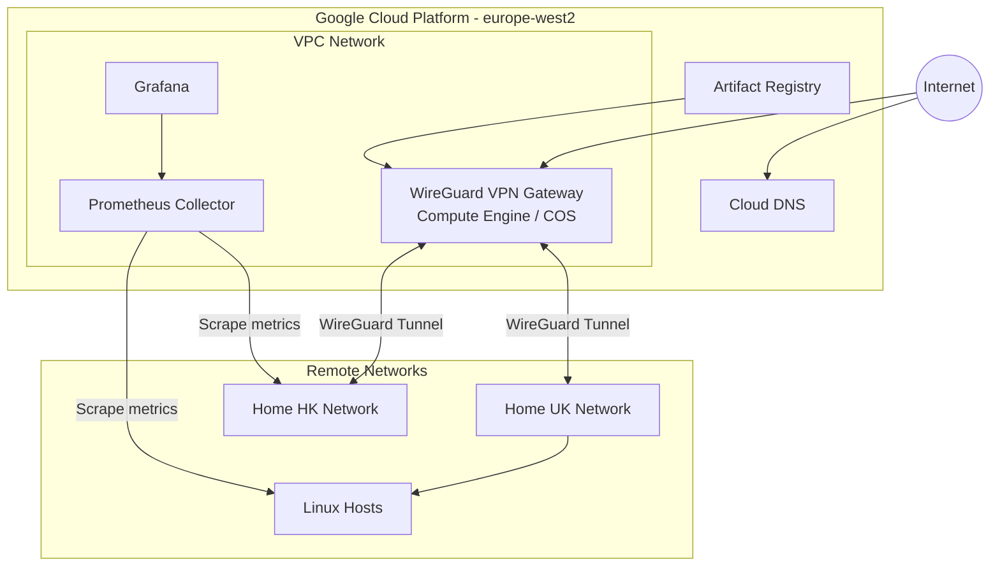

# GCP Infrastructure

Infrastructure-as-Code (IaC) project for managing a personal Google Cloud Platform environment using **Terraform**.

The project provisions and manages networking, VPN connectivity, DNS, container image storage and monitoring infrastructure through reusable Terraform modules.

## Architecture

The infrastructure is deployed primarily in `europe-west2` (London), using Terraform and the Google Cloud provider.

### Infrastructure components

| Component | Description | Terraform module |
|---|---|---|
| VPC Network | VPC, subnets and VPN-related network configuration | `network` |
| WireGuard VPN | Compute Engine-based VPN gateway running WireGuard in a container | `vpn` |
| Cloud DNS | Public DNS zone for `gcp.2am.xyz` | `dns` |
| Artifact Registry | Docker image repository | `artifact_registry` |
| Prometheus Collector | Centralised Prometheus collection for remote Linux hosts | `prometheus-collector` |
| Grafana | Monitoring and visualisation platform | `grafana` |

### High-level architecture



### Network configuration

| Network | CIDR | Purpose |
|---|---|---|
| GCP VM subnet | `10.10.1.0/24` | Internal GCP resources |
| WireGuard network | `10.2.0.0/24` | VPN tunnel addressing |
| Home HK | `192.168.1.0/24` | Remote network |
| Home UK | `192.168.15.0/24` | Remote network |

WireGuard peer configuration:

| Peer | Tunnel address | Remote network |
|---|---|---|
| `home-hk` | `10.2.0.2/32` | `192.168.1.0/24` |
| `home-uk` | `10.2.0.3/32` | `192.168.15.0/24` |

### Monitoring

Prometheus collects metrics from remote Linux hosts through the WireGuard network.

Current scrape targets:

| Instance | Endpoint | Location |
|---|---|---|
| beetle | `192.168.15.175:9100` | Home UK |
| panda | `192.168.1.2:9100` | Home HK |

Grafana provides dashboards and visualisation using Prometheus and Google Cloud Monitoring as data sources.

## Repository structure

```text
.
├── .github/
│   └── workflows/
│       └── terraform-docs.yml
├── .infra/
├── modules/
│   ├── network/
│   ├── artifact_registry/
│   ├── dns/
│   ├── vpn/
│   ├── prometheus-collector/
│   └── grafana/
├── .gitignore
├── .terraform-docs.yml
├── data.tf
├── main.tf
├── outputs.tf
├── providers.tf
└── README.md
```

Each module encapsulates its own Terraform resources, variables and outputs to keep the root configuration maintainable and reusable.

## Prerequisites

Install the following tools:

- [Terraform](https://developer.hashicorp.com/terraform/install)
- [Google Cloud CLI](https://cloud.google.com/sdk/docs/install)
- [terraform-docs](https://terraform-docs.io/)
- Git

### Google Cloud authentication

Authenticate with Google Cloud:

```bash
gcloud auth login
gcloud config set project YOUR_PROJECT_ID
```

Configure Application Default Credentials:

```bash
gcloud auth application-default login
```

Alternatively, use a dedicated service account or an attached GCE service account with the required IAM permissions.

### Required APIs

The Terraform configuration enables the following Google Cloud APIs:

- Identity-Aware Proxy
- Network Management
- Cloud Logging
- Cloud Monitoring
- Secret Manager
- Kubernetes Engine
- Cloud DNS
- Artifact Registry
- Service Usage

The Compute Engine API may also be required by the infrastructure modules and should be enabled where necessary.

### Terraform permissions

The deployment identity requires sufficient IAM permissions to manage the resources defined in the root configuration and its modules.

Typical permissions include:

- Compute Network Admin
- Compute Instance Admin
- DNS Administrator
- Artifact Registry Administrator
- Monitoring Admin
- Service Usage Admin
- IAM permissions for service account management and role bindings
- Storage permissions for Terraform remote state

Use least-privilege IAM roles wherever possible.

## Terraform configuration

### Provider

The project uses the HashiCorp Google provider:

```hcl
terraform {
  required_providers {
    google = {
      source  = "hashicorp/google"
      version = "~> 6.0"
    }
  }

  backend "gcs" {
    bucket = "YOUR_TERRAFORM_STATE_BUCKET"
    prefix = "base"
  }
}

provider "google" {
  project = "YOUR_PROJECT_ID"
  region  = "europe-west2"
}
```

### Remote state

Terraform state is stored in a Google Cloud Storage bucket.

The backend bucket must be created before the initial Terraform deployment. Ensure that the deployment identity has appropriate access to the bucket.

Remote state provides a centralised state location and supports collaboration between deployment environments.

## Deployment

Run Terraform commands from the repository root.

### 1. Initialise Terraform

```bash
terraform init
```

### 2. Validate configuration

```bash
terraform fmt -recursive
terraform validate
```

### 3. Review infrastructure changes

```bash
terraform plan -var-file="default.tfvars" -out=tfplan
```

### 4. Apply infrastructure

```bash
terraform apply tfplan
```

### 5. View Terraform outputs

```bash
terraform output
```

Current root outputs include:

- `docker_repo_url` – Artifact Registry Docker repository URL.
- `gcp_dns_name_servers` – Cloud DNS name servers.

### 6. Destroy infrastructure

To remove the managed infrastructure:

```bash
terraform destroy
```

**Warning:** Destroying infrastructure can interrupt VPN connectivity, monitoring and DNS services. Review the Terraform plan carefully before confirming.

## Terraform modules

The root configuration uses independent modules to provision different infrastructure components.

| Module | Source | Responsibility |
|---|---|---|
| Network | `./modules/network` | VPC, subnets and network configuration |
| Artifact Registry | `./modules/artifact_registry` | Docker image repository |
| DNS | `./modules/dns` | Public Cloud DNS zone |
| VPN | `./modules/vpn` | WireGuard gateway and VPN infrastructure |
| Prometheus Collector | `./modules/prometheus-collector` | Prometheus metrics collection |
| Grafana | `./modules/grafana` | Grafana monitoring platform |

Each module has its own README containing automatically generated Terraform documentation.

See the individual module directories for their implementation details.

## Terraform documentation

This repository uses [terraform-docs](https://terraform-docs.io/) to automatically generate module documentation.

The generated documentation includes:

- Requirements
- Providers
- Resources
- Child modules
- Input variables
- Output values

## Development workflow

Recommended workflow for infrastructure changes:

1. Create a feature branch.
2. Modify the relevant Terraform module or root configuration.
3. Run `terraform fmt -recursive`.
4. Run `terraform validate`.
5. Generate updated Terraform documentation.
6. Review the Terraform plan.
7. Open a pull request for review.
8. Apply the approved infrastructure changes.

Keep infrastructure code, module documentation and deployment configuration version-controlled.

## Security considerations

- Do not commit service account JSON keys, credentials or secrets.
- Store sensitive values in Google Secret Manager.
- Use IAM least-privilege permissions.
- Restrict VPN and management access to trusted networks.
- Protect Terraform state in the GCS backend.
- Review firewall rules and public IP exposure.
- Avoid exposing sensitive Terraform outputs.

## Future improvements

Potential enhancements:

- Automated Terraform validation and planning through GitHub Actions.
- Terraform security scanning with Checkov or Trivy.
- Automated documentation validation in pull requests.
- Separate development and production environments.
- Terraform state and infrastructure drift monitoring.
- Additional GKE infrastructure modules.

---

**Infrastructure managed with Terraform on Google Cloud Platform.**
